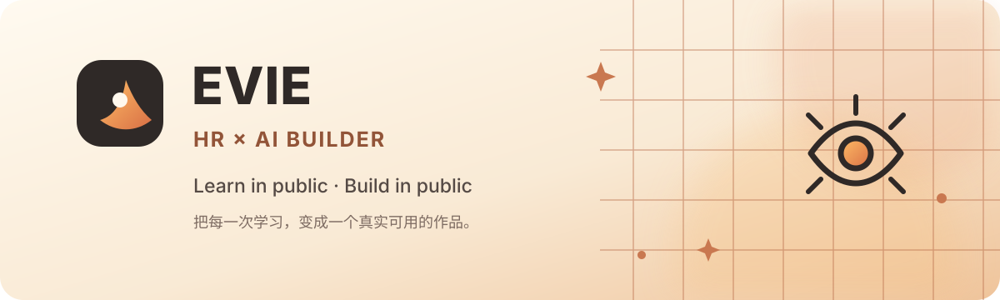

# Hi，我是 Evie 👋

**现役 HR｜AI Builder 成长中**

用技术打辅助，探索 AI 在职场与生活中的无限可能 🚀

## About me

- 📒 **Learn in public**：分享自学笔记、好玩工具与前沿热点
- 🛠️ **Build in public**：把学到的知识变成简单、实用的小工具
- 💼 **HR × AI**：关注 AI 如何改善招聘、工作效率与个人成长
- 💡 欢迎同频的小伙伴，一起交流、实验、打怪升级

## Now building

### [X Follow Tracker](https://github.com/evieliii/x-follow-tracker)

隐私优先的 Chrome / Edge 扩展，在浏览器本地扫描和比较 X 的粉丝关系。

- 识别未回关、取关和新增粉丝
- 所有数据仅保存在本地
- 不需要账号密码，也不会自动关注或取关
- 采用 GPLv3 开源

## Currently exploring

`AI Tools` · `AI Agents` · `HR Tech` · `Productivity`

`Chrome Extensions` · `Content Creation` · `Vibe Coding`

---

**Learn in public. Build in public.**

把每一次学习，都变成一个真实可用的作品。

